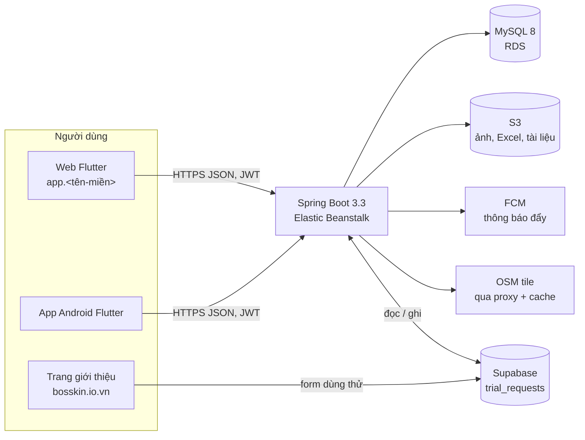

# Kiến trúc

## Thành phần

| Thành phần | Công nghệ | Thư mục |
|---|---|---|
| Backend | Java 17, Spring Boot 3.3, Spring Security, JPA/Hibernate, Flyway, Apache POI, Lombok | `backend/` |
| Frontend | Flutter 3 (web CanvasKit + Android), Riverpod, go_router, Dio, fl_chart, flutter_map, geolocator, firebase_messaging | `frontend/` |
| CSDL | MySQL 8, utf8mb4, giờ `Asia/Ho_Chi_Minh` | migration `backend/src/main/resources/db/migration` |
| Lưu file | S3 (prod) hoặc thư mục local (dev) | `S3Service`, `DocumentStorageService` |
| Hạ tầng | CloudFormation: EB + RDS + S3 + Secrets Manager + SNS | `infra/aws/` |
| Trang giới thiệu | HTML tĩnh + Supabase | `landing/` |
| Trang trợ giúp | HTML tĩnh sinh từ Markdown | `help/` |

## Đường đi của một request

1. `RequestIdFilter` nhận hoặc sinh mã request (header `X-Request-ID`), đưa vào MDC `rid` để mọi dòng log của request có cùng mã, trả lại trong header và trong thân lỗi.
2. Spring Security có hai chuỗi lọc: `/admin/**` chỉ nhận token quản trị hệ thống (`ROLE_SYSTEM_ADMIN`); phần còn lại nhận token người dùng công ty.
   `JwtAuthFilter` đọc `Authorization: Bearer`, nạp `User` (kèm vai trò, quyền) làm principal.
3. Controller lấy `@AuthenticationPrincipal User user`, kiểm mã quyền (`requirePermission(user, "…")` hoặc hàm phụ cùng nghĩa),
   gọi service với `user.getCompanyId()`.
4. Service kiểm phạm vi phòng ban (`DeptScopeService.resolvedScopes`), quy tắc nghiệp vụ, ghi DB trong `@Transactional`, ghi nhật ký
   (`AuditService.log(...)`).
5. Lỗi nghiệp vụ ném `ResponseStatusException` với **mã lỗi i18n** (`error.x.y` hoặc `error.x.y|tham số`); `ApiExceptionHandler` trả
   `{ timestamp, status, error, message: "<mã>", path, requestId }` (lỗi ràng buộc DB → 409 `error.data.conflict`, lỗi lạ → 500
   `error.internal`, không lộ SQL / stacktrace); FE dịch mã sang tiếng Việt / Anh. CI `tools/ci/check_error_keys.py` bảo đảm mọi mã
   có bản dịch.

## Đa công ty

Một DB phục vụ nhiều công ty khách hàng. Gần như mọi bảng nghiệp vụ có `company_id`; service luôn lọc theo
`user.getCompanyId()` và kiểm đối tượng lấy theo id có cùng công ty (không tin id client gửi). Bảng dùng chung mọi công ty: `permissions`,
`tax_policies`, `system_admins`, `trial_requests`, và ngày lễ mẫu (`holidays` có `company_id` trống).

Quản trị hệ thống (nhà cung cấp) có thể **đăng nhập thay** một công ty để hỗ trợ: token mang cờ impersonate (`SysAdminImpersonateUser`),
FE hiện dải cảnh báo, mọi thao tác ghi nhật ký kèm danh tính quản trị viên.

## Cấu trúc backend (`com.bosskin`)

| Gói | Vai trò |
|---|---|
| `controller` | REST, kiểm quyền, map DTO. 39 controller + `audit/AuditLogController` — danh sách ở [api.md](api.md) |
| `service` | Nghiệp vụ. Lớn nhất: `AttendanceCalculationService` / `AttendanceCalculator` (tính công), `PayrollService` + `FormulaEngine` (lương), `LeaveService` (phép + sổ trừ/hoàn), `EmployeeService`, `ContractService`, `DocumentService` |
| `service/descriptor`, `util/Excel*` | Khung Excel chung: mô tả cột (`ExcelColumn`, `ExcelEntityDescriptor`), xuất / xem trước / nhập theo lệnh `CREATE/UPDATE/MERGE/DELETE`, lịch sử file |
| `entity`, `repository` | JPA. `ddl-auto: validate` — entity phải khớp migration |
| `dto` | Request/response theo module (`LeaveDTO.LeaveTypeResponse`…) |
| `core` | Logic thuần, dễ test: `WorkFlagCalculator`, `PayrollPeriod`, `PasswordPolicy`, `Totp`, `SensitiveData` |
| `security` | JWT, nạp user, chống dò mật khẩu |
| `config` | Security, S3, FCM, đồng hồ (`Clock` để test giờ), bootstrap system admin |
| `audit` | Nhật ký thao tác |
| `i18n` | Thông điệp, tên cột Excel (`excel_vi/en.properties`) |

Múi giờ: JVM đặt `Asia/Ho_Chi_Minh` lúc khởi động; dùng `Clock` tiêm vào để test.

## Cấu trúc frontend (`frontend/lib`)

| Thư mục | Vai trò |
|---|---|
| `core/config` | `ServerConfig` (API_HOST lúc build), hằng số |
| `core/navigation` | `nav_menu.dart` (menu nhóm theo mục), `nav_access.dart` (mục nào cần quyền nào), go_router |
| `core/theme`, `core/localization`, `l10n/` | Giao diện sáng/tối, chuỗi `app_vi.arb` / `app_en.arb` (CI chặn chuỗi Việt viết cứng: `tools/ci/check_vi_literals.py`) |
| `data/models`, `data/repositories`, `data/services` | Model JSON, gọi API bằng Dio (tự refresh token), FCM, vị trí |
| `presentation/screens/<module>` | Màn hình theo module (attendance, shift, leaves, payroll, employee, contracts, documents, roles, admin…) |
| `presentation/widgets` | Widget dùng chung (bảng, bộ lọc, hộp thoại xem trước import…) |

Menu và route ẩn theo quyền của người dùng (lấy từ `/auth/login` và `/profile`); backend vẫn kiểm lại mọi request.

## Việc chạy nền

| Lịch (giờ VN) | Lớp | Việc |
|---|---|---|
| 00:05 hằng ngày | `JobHistoryService` | Áp các mốc quá trình công tác đến ngày hiệu lực (chuyển phòng, chức vụ, quản lý) |
| 00:15 hằng ngày | `LeaveAccrualScheduler` | Cộng phép tự động theo quy tắc |
| 07:30 hằng ngày | `ContractService` | Báo hợp đồng còn 0 / 7 / N ngày hết hạn cho người có `CONTRACT_VIEW` |
| 07:35 hằng ngày | `DocumentService` | Báo tài liệu nhân sự sắp hết hạn |
| mỗi phút | `ShiftReminderScheduler` | Nhắc ca sắp bắt đầu (theo phút nhắc người dùng chọn) |
| mỗi phút | `CheckInOutReminderScheduler` | Nhắc check-in / check-out |

Chạy trong chính tiến trình app. Khi tăng lên nhiều máy EB, mỗi máy sẽ chạy các việc này — cần khoá phân tán (ShedLock) trước khi scale ngang.

## Thông báo, file, bản đồ

- **Thông báo** (V33): `PushService.notifyUser` ghi MỘT bản vào hộp thư `user_notifications` (`/api/v1/notifications`, đăng nhập máy nào cũng đọc cùng danh sách, dọn sau 90 ngày) rồi đẩy FCM (`FcmService`) tới thiết bị nhận thông báo của tài khoản (`fcm_tokens`: mỗi tài khoản một thiết bị — máy bật sau cùng; một token chỉ thuộc một tài khoản). Nhắc ca / check-in / check-out do scheduler gọi `PushService.record` + gửi từng thiết bị. Quản lý trực tiếp bật `users.notif_late_alert` / `notif_early_leave_alert` để nhận báo nhân viên check-in trễ / check-out sớm (`AttendanceAlertService`). Thiếu `FIREBASE_SERVICE_ACCOUNT_JSON` thì tắt push, hộp thư vẫn ghi, app vẫn chạy. Log gửi nhắc ca ở `fcm_notification_logs`.
- **Ảnh** (avatar, ảnh công ty): S3 `company-*/avatars|images/*`, đọc công khai. **Excel lịch sử**: `excel-history/`, tự xoá sau 1 năm.
  **Tài liệu nhân sự**: `documents/`, riêng tư, chỉ cấp link ký tạm (mặc định 300 giây), mỗi lần lấy link ghi nhật ký.
- **Bản đồ** (chọn vị trí chấm công): FE không gọi thẳng OpenStreetMap mà qua `/api/v1/map-tiles/{z}/{x}/{y}.png` — cache đĩa, giới hạn
  vùng Việt Nam, giới hạn tốc độ theo người dùng.

## Kiểm thử

- Backend: JUnit + Testcontainers MySQL (`./mvnw test`), chạy ở CI `test.yml` khi push `main` + PR.
- Frontend: `flutter test` (`frontend/test`), build web ở CI `frontend-build.yml`.
- Hạ tầng: `cfn-lint` ở `infra-lint.yml`. Tài liệu tự sinh: `python3 tools/docs/gen_he_thong.py --check`.
