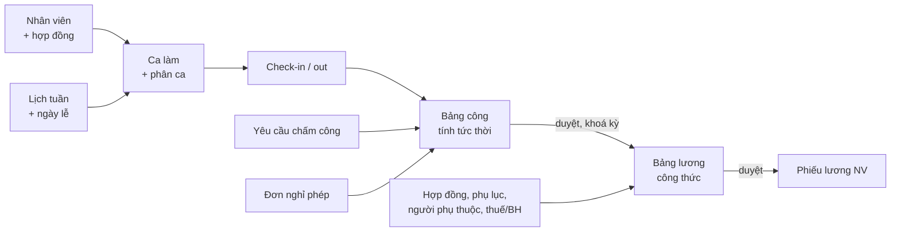

# Nghiệp vụ

Hướng dẫn thao tác cho người dùng ở trang trợ giúp (`help/`). Sơ đồ luồng có hình ở
[review 10/2026 — luồng nghiệp vụ](../review-2026-10/luong-nghiep-vu.html). Trang này tóm các quy tắc mà code phải giữ.

## Luồng tổng

## Module

| Module | Bảng chính | Quy tắc đáng nhớ |
|---|---|---|
| Nhân viên | `employees`, `employee_code_counters`, `employee_job_histories` | Mã NV cấp từ bộ đếm theo tiền tố, không tái dùng sau khi xoá. Chuyển phòng / chức vụ / lương / quản lý qua quá trình công tác, mốc tương lai áp lúc 00:05 ngày hiệu lực |
| Phòng ban, chức vụ | `departments`, `positions` | Cây phòng ban chặn vòng lặp, `level` tính lại khi đổi cha; nhập Excel 2 lượt (tạo rồi gắn cha) |
| Hồ sơ tự phục vụ | `profile_edit_requests`, `employee_dependents`, `employee_documents` | Nhân viên gửi yêu cầu sửa; người duyệt thấy giá trị cũ → mới (lưu lúc duyệt) |
| Hợp đồng | `labor_contracts`, `contract_appendices`, `contract_allowances` | Thời hạn kiểm theo loại HĐ; mỗi NV tối đa một HĐ hiệu lực; phụ lục tăng lương có ngày hiệu lực → lương tính theo phần ngày trong kỳ |
| Ca làm | `work_shifts`, `department_shifts`, `shift_assignments`, `shift_rotations`, `shift_swap_requests` | Ca cố định / linh hoạt / qua đêm / ca gãy; phân ca chặn chồng giờ; xoay ca bỏ ngày lễ và giữ ngày đã có công; không xoá phân ca đã có check-in/out, đã duyệt công, có đơn chấm công chờ duyệt (`error.shiftAssignment.has_pending_request`) hoặc đơn đã duyệt đang áp dụng — đơn bị từ chối / đã huỷ / đã tắt áp dụng không chặn |
| Chấm công | `attendances`, `attendance_requests`, `attendance_period_locks`, `employee_locations` | Công tính tức thời từ giờ vào / ra + ca + dung sai, chỉ lưu khi duyệt. Kỳ khoá thì mọi sửa bị chặn. Vị trí: bán kính công ty hoặc phòng; thiết bị gắn theo NV |
| Nghỉ phép | `leave_types`, `leave_grants`, `leave_ledger_entries`, `leave_requests`, `leave_accrual_rules` | Chỉ trừ ngày có ca, bỏ ngày lễ và giờ nghỉ trưa. Sổ trừ / hoàn ghi đúng quỹ đã trừ; huỷ / từ chối hoàn lại |
| Lịch | `work_calendars`, `holidays` (`company_id` trống = mẫu hệ thống) | Lịch tuần 7 ký tự (`F` cả ngày, `H` nửa ngày, `O` nghỉ) theo phòng, phòng con kế thừa. Ngày lễ: mẫu hệ thống → chép riêng khi công ty sửa năm đó |
| Lương | `salary_grades`, `salary_histories`, `formula_variables`, `salary_formulas`, `payrolls`, `tax_policies` | Kỳ theo ngày chốt; công thức có biến hệ thống + biến tự định nghĩa; thuế / BH theo chính sách hiệu lực ở **ngày cuối kỳ**; phiếu lưu snapshot; không tự duyệt phiếu của mình |
| Báo cáo | (đọc) | Tổng quan, nhân sự, chấm công, lương, danh sách đóng BH; luôn lọc theo phạm vi |
| Excel | `excel_history` | Xuất / xem trước / nhập theo lệnh, thứ tự module theo phụ thuộc, file kết quả có dòng lỗi |
| Nhật ký | `audit_logs` | Chỉ ghi thêm; ghi cả lần xem tài liệu nhạy cảm |

## Biến lương hệ thống

Định nghĩa ở `PayrollService` / `FormulaEngine`; danh sách đầy đủ cho người dùng ở trang trợ giúp *Bảng lương*.

| Nhóm | Biến |
|---|---|
| Công | `STANDARD_WORK_DAYS`, `PRESENT_DAYS`, `ABSENT_DAYS`, `LEAVE_DAYS`, `PAID_LEAVE_DAYS`, `UNPAID_LEAVE_DAYS`, `LATE_IN_DAYS`, `EARLY_OUT_DAYS`, `ON_TIME_DAYS`, `OVERTIME_DAYS` |
| Giờ | `DAY_HOURS`, `NIGHT_HOURS`, `DAY_OT`, `NIGHT_OT`, `TOTAL_OT_HOURS`, `HOURS_PER_DAY`, `BASE_RATE` |
| Hợp đồng | `CONTRACT_SALARY`, `CONTRACT_ALLOWANCE`, `ALLOWANCE_<mã>`, `TAXABLE_ALLOWANCE`, `NON_TAXABLE_ALLOWANCE` |
| Bảo hiểm | `INSURANCE_SALARY`, `INSURANCE_BASE`, `INSURANCE_CAP`, `INSURANCE_FLOOR`, `UNEMPLOYMENT_BASE`, `UNEMPLOYMENT_CAP`, `SOCIAL_INS`, `HEALTH_INS`, `UNEMPLOYMENT_INS`, `TOTAL_INSURANCE` |
| Thuế | `PERSONAL_DEDUCTION`, `DEPENDENT_DEDUCTION`, `DEPENDENTS`, `FAMILY_DEDUCTION`, `PIT`, hàm `PIT_VN(x)` |
| Khác | `HOLIDAY_DAYS`, `HOLIDAY_OT_HOURS`, `TENURE_DAYS`, `TENURE_MONTHS`, `TENURE_YEARS`, `GROSS`, `BONUS`, `OTHER_DEDUCTIONS` |

Thêm biến hệ thống mới: khai báo trong `PayrollService`, thêm vào danh sách gợi ý ở FE, cập nhật bảng trên và trang trợ giúp *Bảng lương*.
