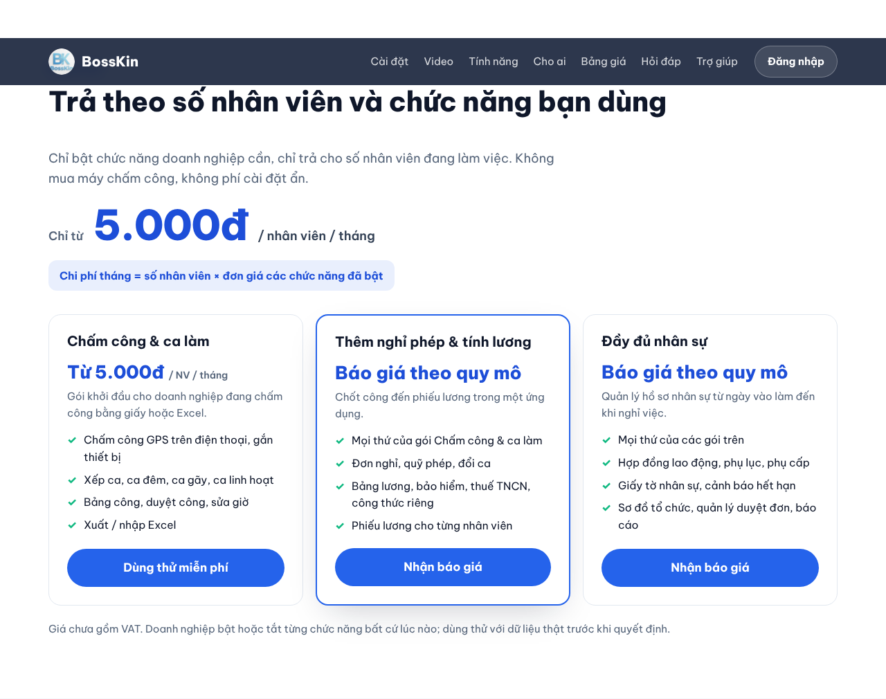
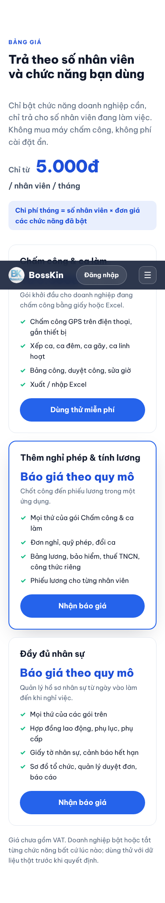

# Bảng giá trên trang giới thiệu (16/10/2026)

Mục `#bang-gia` ở `landing/index.html`, nằm giữa "Cho ai" và "Hỏi đáp"; có link ở menu đầu trang và chân trang, và một câu hỏi trong phần Hỏi đáp.

## Quyết định của chủ dự án
- Chỉ từ **5.000đ / nhân viên / tháng**.
- Giá tính theo **cả số nhân viên và chức năng** bật (khớp `goi-chuc-nang.md`: app chỉ giữ công tắc, tiền tính ngoài app).

- Dùng thử **miễn phí 1 tháng**; hỗ trợ **cài đặt** và **xử lý sự cố 24/24** (ghi ở chú thích mục giá, Hỏi đáp và poster).
- Poster in A3 bản bảng giá: `docs/in-an/poster-bang-gia-a3.html` (+ `pdf/`, `anh/`).

## Bố cục
Tiêu đề + dòng giá lớn "Chỉ từ 5.000đ" + công thức `số NV × đơn giá các chức năng đã bật`, rồi 3 thẻ gói (thẻ giữa nổi bật):

| Gói | Giá hiển thị | Chức năng |
| --- | --- | --- |
| Chấm công & ca làm | Từ 5.000đ / NV / tháng | chấm công GPS, xếp ca, bảng công, Excel |
| Thêm nghỉ phép & tính lương | Báo giá theo quy mô | + nghỉ phép, đổi ca, lương, BH, thuế |
| Đầy đủ nhân sự | Báo giá theo quy mô | + hợp đồng, giấy tờ, sơ đồ tổ chức, báo cáo |

Ghi chú chân mục: giá chưa gồm VAT, bật / tắt chức năng bất cứ lúc nào. Giao diện tối / sáng theo biến CSS của trang; 3 cột → 1 cột dưới 900px.

## Còn chờ chủ dự án
Giá của gói 2 và gói 3, mức giảm theo số nhân viên (nếu có), có ghi "chưa gồm VAT" hay không.

## Ảnh

